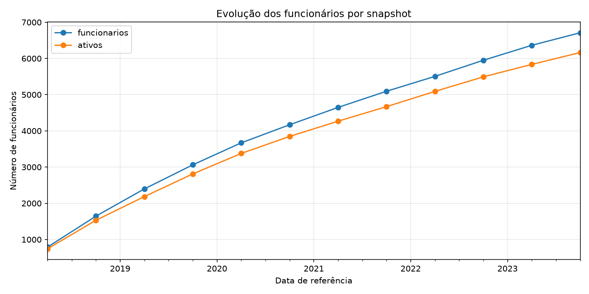
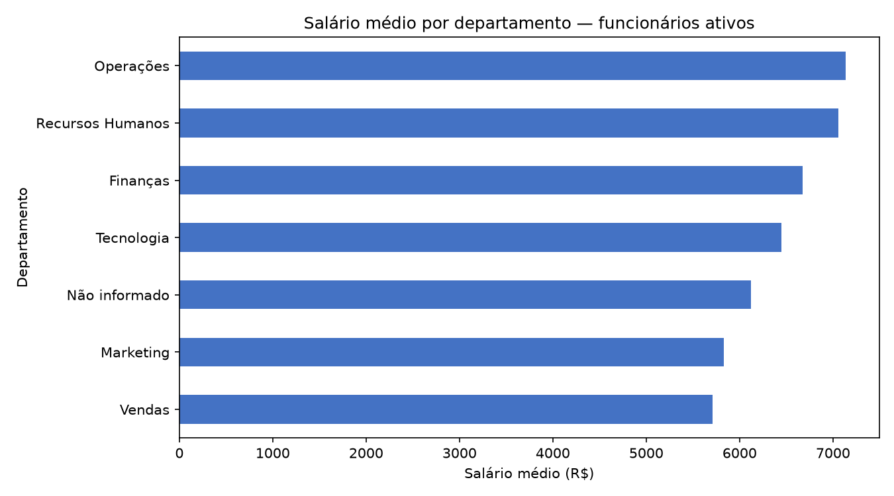
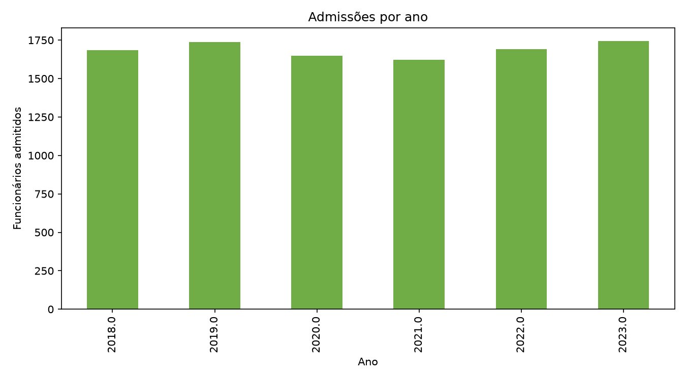
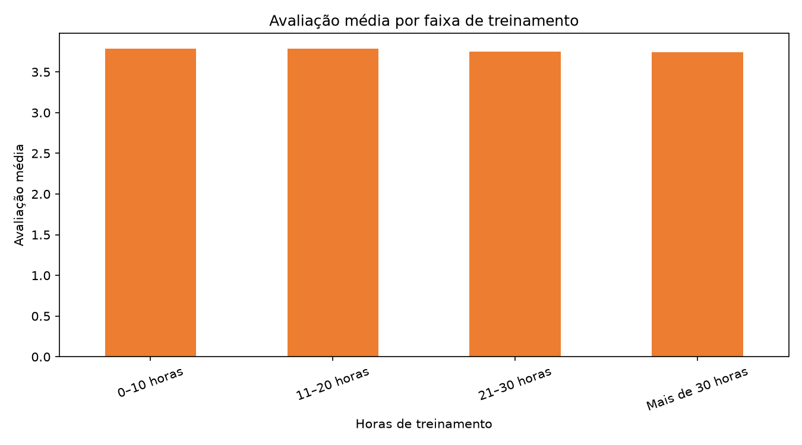
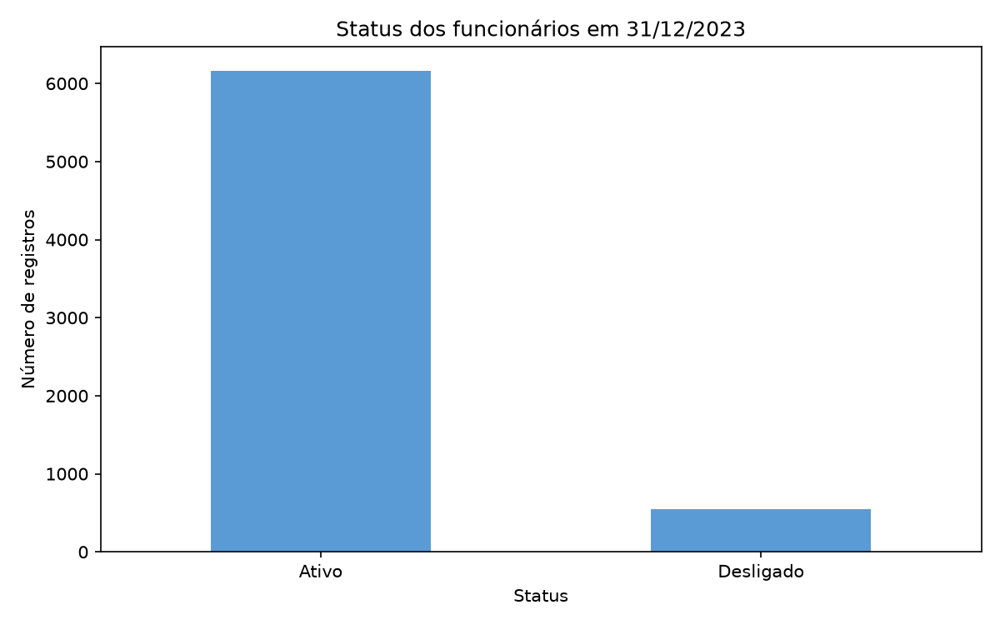

# Projeto Prático — Análise de RH

## Objetivo
Analisar a evolução dos funcionários, salários, admissões e avaliações de desempenho para identificar informações úteis à gestão de pessoas.

## Base de dados e método
A base possui 50.000 registros em snapshots semestrais entre 2018 e 2023. Como o mesmo funcionário aparece em diferentes períodos, os registros históricos foram preservados. Para descrever a situação mais recente, foi usado o snapshot de 31/12/2023.

Foram encontrados valores ausentes em escolaridade e departamento, além de datas de desligamento vazias. Idades fora da faixa de 18 a 100 anos foram tratadas como inválidas. Os registros com data de desligamento vazia foram preservados.

## Principais resultados
- No snapshot de 31/12/2023 havia 6.710 funcionários registrados, sendo 6.163 ativos e 547 desligados.
- Ao longo de todo o histórico, foram identificados 10.155 funcionários distintos.
- A proporção de registros classificados como desligados no snapshot mais recente foi de 8,15%. Esse indicador descreve a situação naquela data; não é uma taxa de rotatividade.
- Entre os funcionários ativos, Operações apresentou o maior salário médio (R$ 7.137,12), e Vendas, o menor (R$ 5.710,79).
- A avaliação média dos ativos foi 3,77, e a média de horas de treinamento foi 19,9.
- As avaliações médias por faixa de treinamento variaram de 3,74 a 3,79. A diferença observada é pequena e não demonstra que o treinamento cause mudança no desempenho.
- O número de funcionários registrados por snapshot aumentou de 789 em junho de 2018 para 6.710 em dezembro de 2023.

## Gráficos

### Evolução dos funcionários

O gráfico compara o total de funcionários registrados e os ativos em cada snapshot semestral. O quadro registrado cresceu ao longo do período analisado.

### Salário por departamento

O gráfico compara os salários médios dos funcionários ativos entre departamentos. Operações apresentou a maior média e Vendas, a menor.

### Admissões por ano

O gráfico mostra a quantidade de funcionários distintos por ano de admissão. Ele permite comparar os anos, mas não representa sozinho o crescimento líquido da equipe.

### Treinamento e desempenho

As avaliações médias ficaram próximas entre as faixas de treinamento. Essa comparação é descritiva e não permite afirmar que o treinamento causou diferenças nas avaliações.

### Status dos funcionários

O gráfico apresenta os status registrados em 31/12/2023. Os desligados representam 8,15% dos registros desse snapshot.

## Estudo aplicado
**Pergunta:** As avaliações médias diferem entre funcionários ativos com diferentes quantidades de horas de treinamento?

**Método:** Os funcionários ativos no snapshot mais recente foram agrupados por faixa de horas de treinamento, e a avaliação média foi calculada para cada grupo.

**Conclusão e recomendação:** As médias variaram pouco, de 3,74 a 3,79. A análise não mostra uma diferença expressiva nem comprova relação de causa e efeito. Como próximo estudo, recomenda-se comparar avaliações do mesmo funcionário antes e depois de treinamentos, considerando também departamento e cargo.

## Como executar
Instale as dependências com `pip install pandas matplotlib` e execute `python main.py`.